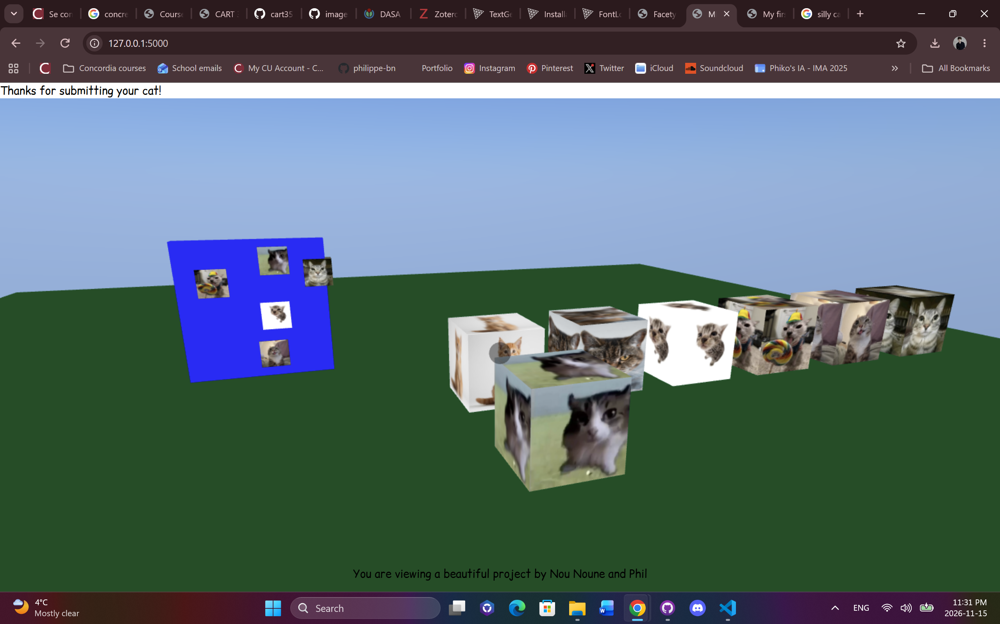
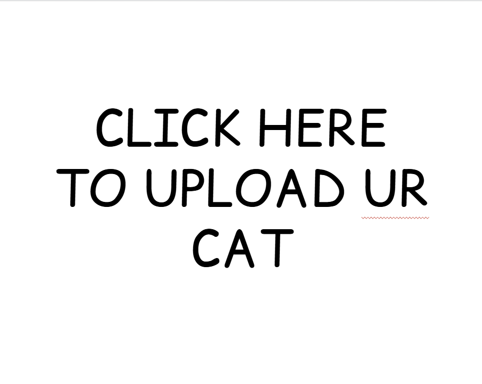

# CATCLAIM
by Philippe Beauchemin and Nou Noune (Amélie Barrette), 2026

An interactive web experience that combines Three.js with an implementation of POST requests to retrieve and display cat images from users. On the experience's homepage, "Place a cat on the façade and admire the other cats" instructs the user to playfully add to the database.

---

## Attributions

- Made with the Three.js library, MIT License https://threejs.org/
- Pointer Lock Controls from 'three/addons/controls/PointerLockControls.js'
- Sky object from 'three/addons/objects/Sky.js'

> In an earlier prototype, the "upload" block was initially blue and turned red once the raycast center of the screen intersected with it. Once red, the user could click on it to make the upload form appear.
> 

> To make the experience more intuitive, we added text to the block through adding an image, as suggested as an option on the [Three manual](https://threejs.org/manual/#creating-text).
> 

## License

> This project is licensed under a Creative Commons Attribution ([CC BY 4.0](https://creativecommons.org/licenses/by/4.0/deed.en)) license with the exception of libraries and other components with their own licenses.